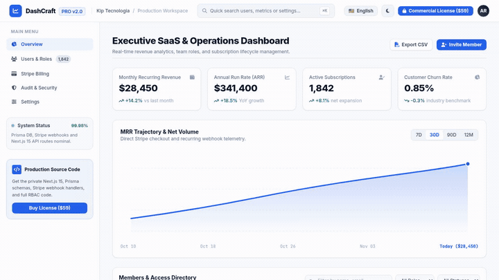

# 📊 DashCraft Pro v2.0 - Enterprise SaaS Admin & Analytics

[](https://nextjs.org/)
[](https://www.typescriptlang.org/)
[](https://prisma.io)
[](https://www.radix-ui.com/)
[](https://stripe.com)
[](https://kiptecnologia.github.io/dashcraft-pro/)
[](https://github.com/KipTecnologia)
[](https://kiptecnologia.github.io/dashcraft-pro/)

> **English**: Production-ready **Enterprise B2B SaaS Admin & Analytics Dashboard Boilerplate**. Built with **Next.js 15 App Router**, **React 19**, **TypeScript**, **Mantine / Radix UI design tokens**, **Prisma ORM (RBAC, Audit Logs, Memberships)**, and **Turnkey Stripe SaaS Subscriptions**. Default clean corporate light aesthetic (zero AI-cliché dark neon).  
> **Português**: Painel Administrativo Executivo e Boilerplate Micro-SaaS completo para aplicações B2B. Desenvolvido com **Next.js 15**, **TypeScript**, **tokens Radix/Mantine**, **Prisma ORM (RBAC)** e **Stripe**. Criado e mantido por **[Kip Tecnologia](https://github.com/KipTecnologia)**.

---

## ⚡ Live Interactive Demo (Bilingual EN / PT)

Experience the live executive dashboard with 1-click English 🇺🇸 / Portuguese 🇧🇷 toggle:  
👉 **[https://kiptecnologia.github.io/dashcraft-pro/](https://kiptecnologia.github.io/dashcraft-pro/)**



- **🏛️ Refined Enterprise Aesthetic**: Light mode as primary, high-trust corporate design inspired by Linear, Mantine, and Radix. Also includes a seamless Carbon Slate dark mode.
- **📈 Interactive Revenue Analytics**: Real-time trajectory charts with variable ranges (7D, 30D, 90D, 12M).
- **🛡️ Granular RBAC Team Table**: Role filtering (Owner, Admin, Manager, Developer, Billing) and status filters (Active, Trial, Past Due, Canceled).
- **⚡ Instant CSV Export**: Native browser-based data export without server latency.
- **⌨️ Command Palette (`⌘K` / `Ctrl+K`)**: Rapid navigation and shortcut modal.
- **💳 Turnkey Stripe SaaS Monetization**: Integrated checkout flows, plan tiers ($49 Starter, $149 Pro, $499 Enterprise), and automated webhooks.

---

## 🏗️ Production Micro-SaaS Architecture

```
dashcraft-pro/
├── prisma/
│   └── schema.prisma                # User, Workspace, Membership, Subscription, Invoice, AuditLog
├── src/
│   ├── app/
│   │   ├── api/
│   │   │   ├── analytics/
│   │   │   │   └── metrics/route.ts # Aggregated revenue & MRR trajectory API
│   │   │   ├── users/
│   │   │   │   └── route.ts         # User management, filtering & RBAC assignment
│   │   │   └── stripe/
│   │   │       ├── checkout/route.ts# Stripe Checkout session creator
│   │   │       └── webhook/route.ts # Subscription events, renewals & cancellations
│   │   ├── globals.css              # Custom Radix scrollbars, design variables
│   │   ├── layout.tsx               # Root layout & Metadata
│   │   └── page.tsx                 # Full interactive dashboard & analytics suite
│   ├── lib/
│   │   ├── db.ts                    # Prisma client singleton
│   │   └── stripe.ts                # Stripe SDK & SaaS pricing tiers
│   └── types/
│       └── dashboard.ts             # TypeScript definitions for metrics, roles & users
├── .env.example                     # Preconfigured environment templates
├── package.json
└── README.md
```

---

## 🚀 Quick Start Guide (English)

### 1. Installation
```bash
git clone https://github.com/KipTecnologia/dashcraft-pro.git
cd dashcraft-pro
npm install
```

### 2. Configure Environment Variables
Copy `.env.example` to `.env`:
```bash
cp .env.example .env
```
Key configurations:
- `DATABASE_URL`: Connection string for SQLite or PostgreSQL (Supabase / Neon).
- `NEXTAUTH_SECRET`: Secret key for authentication sessions.
- `STRIPE_SECRET_KEY`: Stripe API secret for SaaS checkout and billing portal.

### 3. Initialize Database & Run
```bash
npx prisma db push
npm run dev
```
Open [http://localhost:3000](http://localhost:3000) to view your dashboard.

---

## 🇧🇷 Guia de Início Rápido (Português)

### 1. Instalação e Execução
```bash
git clone https://github.com/KipTecnologia/dashcraft-pro.git
cd dashcraft-pro
npm install
cp .env.example .env
npx prisma db push
npm run dev
```

### 2. Configurar Variáveis de Ambiente
Preencha as chaves do Stripe e do Banco de Dados no arquivo `.env`. A aplicação suporta SQLite para desenvolvimento rápido ou PostgreSQL / Supabase para produção em grande escala.

---

## 🏢 About Kip Tecnologia

**DashCraft Pro** is engineered and maintained by **Kip Tecnologia**.

- **Website**: [kiptecnologia.com.br](https://kiptecnologia.com.br)
- **GitHub**: [github.com/KipTecnologia](https://github.com/KipTecnologia)
- **Support**: `contato@kiptecnologia.com.br`

---

## 💎 Commercial Licensing vs. Public Demo

| Feature / Asset | Public Interactive Demo (Free) | Commercial License & Full Boilerplate (Paid) |
| :--- | :---: | :---: |
| **Interactive SaaS Analytics Dashboard** | ✅ Free Access | ✅ Included |
| **Bilingual Switcher (EN / PT)** | ✅ Included | ✅ Included |
| **CSV Client Export & Filtering** | ✅ Included | ✅ Included |
| **Next.js 15 App Router Full Source Code** | ❌ (Commercial) | ✅ **100% Unlocked** |
| **Prisma ORM (RBAC, Audit Logs, Invoices)** | ❌ (Commercial) | ✅ **Production Models** |
| **API Endpoints (Metrics, Users, Subscriptions)** | ❌ (Commercial) | ✅ **Production Endpoints** |
| **Stripe Checkout & Automated Webhooks** | ❌ (Commercial) | ✅ **Turnkey Setup** |
| **Command Palette (`⌘K`) Component** | ❌ (Commercial) | ✅ **Fully Modular** |
| **100% White-Label Rights (Launch your own SaaS)** | ❌ (Evaluation only) | ✅ **Full Commercial Rights** |
| **Lifetime Updates & Priority Support** | ❌ (Evaluation only) | ✅ **Included** |

👉 **[Acquire Commercial License & Full Boilerplate on Gumroad](https://rancharia.gumroad.com)**

---

## 📄 License

This repository is governed by the **Kip Tecnologia Commercial & Evaluation License (v2.0)**. The interactive demo and public assets are available for evaluation purposes. Commercial reproduction, distribution, and SaaS operation require a valid Commercial License from Kip Tecnologia. Copyright (c) 2026 Kip Tecnologia.
